# Launchpad X with CoreFW: User Manual

This manual explains, in plain words, everything the custom firmware on your
Novation Launchpad X can do and how to operate it. You do not need to know
anything about firmware to use it. If you only want to **play**, read
[Quick start](#1-quick-start) and the chapter of the mode you like. If you want to
**install, update or go back to the original firmware**, read
[Installing, updating and going back](#12-installing-updating-and-going-back).

> **Launchpad X only.** This firmware port was developed and tested on a Launchpad X
> and on no other model. Do not install it on a Mini, Pro, Mk2 or S. See
> [tested-hardware.md](tested-hardware.md).

> **Please read this once.** This is an unofficial, experimental firmware. It is
> not made by or supported by Novation. Installing it is done at your own risk,
> although it is designed so that you can always go back (see chapter 12). The
> parts of the firmware that have been tried on a real Launchpad X, and the parts
> that have not, are listed in [What has been tested](#13-what-has-been-tested).

## Contents

1. [Quick start](#1-quick-start)
2. [The buttons and pads](#2-the-buttons-and-pads)
3. [Switching on, and the modes](#3-switching-on-and-the-modes)
4. [Note Mode](#4-note-mode) (Chromatic, Scale, Drum and Chord)
5. [Custom Modes](#5-custom-modes) (faders, drum rack, keyboard, program changes)
6. [The sequencer](#6-the-sequencer)
7. [Session mode (Ableton Live)](#7-session-mode-ableton-live)
8. [Performance and Programmer mode](#8-performance-and-programmer-mode)
9. [Setup](#9-setup) (brightness, colors, velocity, aftertouch, rotation)
10. [Connecting to other gear: MIDI](#10-connecting-to-other-gear-midi)
11. [What the firmware cannot do (yet)](#11-what-the-firmware-cannot-do-yet)
12. [Installing, updating and going back](#12-installing-updating-and-going-back)
13. [What has been tested](#13-what-has-been-tested)
14. [Troubleshooting](#14-troubleshooting)
15. [Words explained](#15-words-explained)

---

## 1. Quick start

1. Plug the Launchpad X into your computer (or a USB power source) with a USB
   cable. A short light show plays, then the pads light up: you are in **Note
   Mode**.
2. Press any pad: it plays a note. The notes go out over USB MIDI, so the
   Launchpad needs to be connected to a synthesizer, a drum machine or music
   software (see [chapter 10](#10-connecting-to-other-gear-midi)). The Launchpad
   makes no sound by itself.
3. Pads that are **blue** are notes of the scale (C minor at first), **purple**
   pads are the root note C. Pads that are dark play notes outside the scale.
4. **Up** and **Down** (the top-row arrows) move the whole keyboard an octave up or
   down, **Left** and **Right** move it a semitone.
5. Press **Custom** for the faders and other control surfaces, **hold Capture MIDI
   and press Custom** for the step sequencer, and **Note** to come back here.

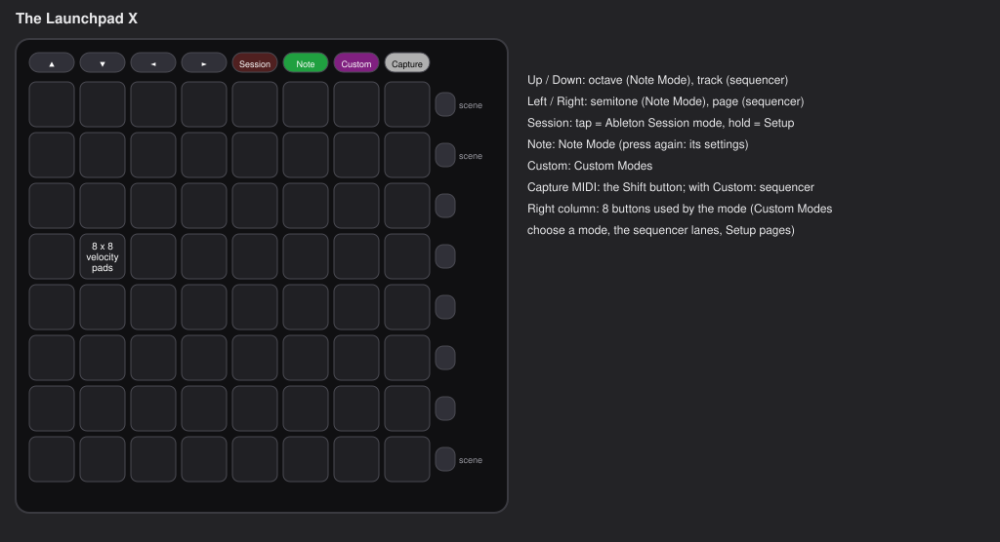

## 2. The buttons and pads

The Launchpad X has **64 pads** (the square, velocity-sensitive grid) and **16
buttons** around them: eight in the top row and eight in the column on the right.

| Part | What it is called here |
| --- | --- |
| The 8 x 8 square grid | the **pads**. Rows are counted from the bottom (row 1) to the top (row 8) |
| Top row: ▲ ▼ ◄ ► | **Up**, **Down**, **Left**, **Right** (the arrows) |
| Top row: Session | **Session** |
| Top row: Note | **Note** |
| Top row: Custom | **Custom** |
| Top row: Capture MIDI | **Capture MIDI**. In this firmware it is also the **Shift** button |
| The column on the right | the **right-hand buttons** or **scene buttons** (eight of them) |

Words used in this manual:

- **Press** or **tap**: push a button or pad briefly.
- **Hold**: keep it down.
- **Shift**: hold **Capture MIDI** while you do something else. In the sequencer
  and in the Custom Modes it opens extra functions.
- **Lit**: the pad or button glows. **Pale green** on a button usually means
  "this is the one that is active"; **dim white** means "available".

The firmware does not change what is printed on the buttons: **Note** goes to Note
Mode, **Custom** to the Custom Modes, **Session** to Session mode, the arrows move
things. Buttons that the original Launchpad Pro Mk3 has but the X does not have
(Chord, Sequencer, Shift, Track Select) are given a place as described below.

## 3. Switching on, and the modes

When the Launchpad is plugged in, a **boot animation** plays and then the
firmware starts in **Note Mode**.

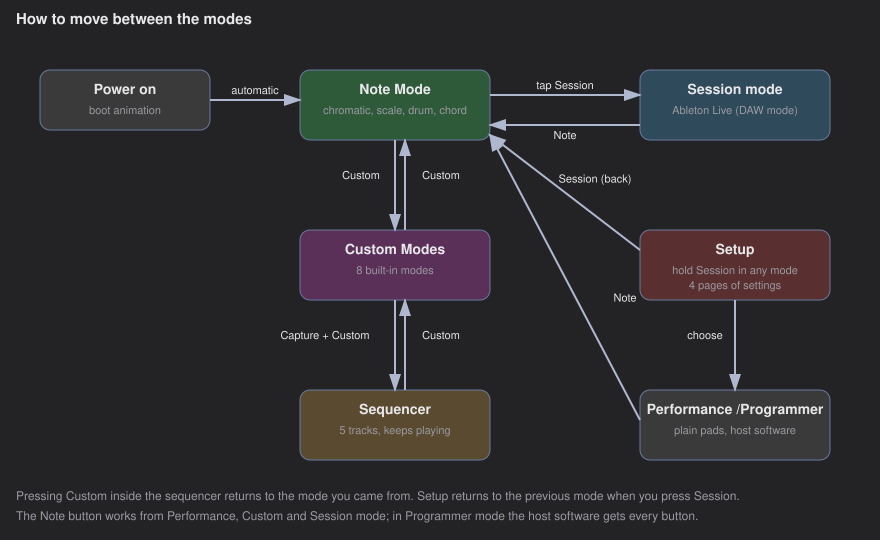

| You want | Do this |
| --- | --- |
| Note Mode (playing notes) | **Note** (works from Custom, Session and Performance mode); it is also where the Launchpad starts |
| Note Mode settings (layout, scale, ...) | press **Note** again while in Note Mode; press it once more to leave |
| Custom Modes | **Custom** (press **Custom** again to go back) |
| The step sequencer | hold **Capture MIDI** and press **Custom** (press **Custom** again to go back) |
| Ableton Live Session mode | a short **tap on Session** |
| Setup (settings, other modes) | **hold Session** for about half a second; press **Session** again to leave |
| Performance or Programmer mode | hold **Session** to open Setup, then choose the mode (chapter 9) |

The sequencer keeps playing in the background while you use another mode. Note
that the **Note** button is **Play** while you are inside the sequencer, so press
**Custom** first to leave it.

In **Programmer mode** the software that controls the Launchpad gets every
button, so the Note button does not leave it; use Setup (hold Session) instead.

## 4. Note Mode

Note Mode turns the pads into an instrument. It has four **layouts**: Chromatic,
Scale, Drum and Chord. All of them send notes over MIDI **channel 1** at first
(you can change the channel). **How hard you press** decides how loud a note is.
If your Launchpad is set up for aftertouch (chapter 9), pressing harder while a
note is held sends pressure messages.

Note names in this manual follow Ableton Live: middle C (MIDI note 60) is "C3", so
the bottom-left pad at the start is note 36 = "C1".

### 4.1 Playing

| Button | What it does in Note Mode |
| --- | --- |
| **Up** / **Down** | the whole keyboard moves one octave up / down (from 3 octaves down to 5 up) |
| **Left** / **Right** | the whole keyboard moves one semitone down / up (up to 11 each way) |
| **Note** | open or close the settings page (4.6) |
| **Custom**, **Session**, **Capture MIDI** | as in the table in chapter 3 |

A note always stops when you let go of its pad, even if you changed the octave
while holding it. Pads that would play a note outside the MIDI range (0 to 127)
stay dark and silent.

**Pad colors**

| Color | Meaning |
| --- | --- |
| Blue | a note of the current scale |
| Purple | the root of the scale |
| White | a pad you are pressing |
| Dark | Chromatic layout: a note outside the scale (it still plays). No note on that pad |
| Dim yellow | Drum layout: a drum pad |
| Orange | Chord layout: a triad pad |

### 4.2 Chromatic layout (the default)

Every pad is a semitone. The default arrangement (called **overlap 5**) is like a
guitar neck: each pad up a row adds 5 semitones, so a chord shape stays the same
wherever you play it. The scale is shown by color, but you may play any note.

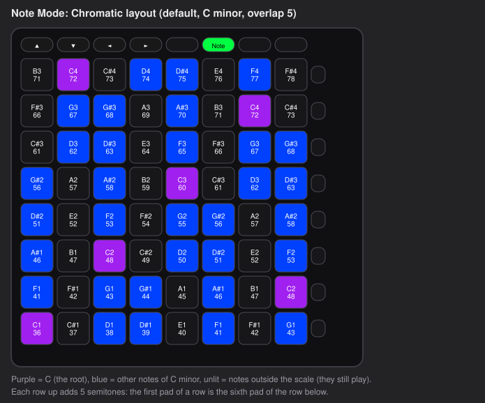

### 4.3 Scale layout

Only the notes of the current scale exist, so you can never play a wrong note. The
bottom-left pad is the root.

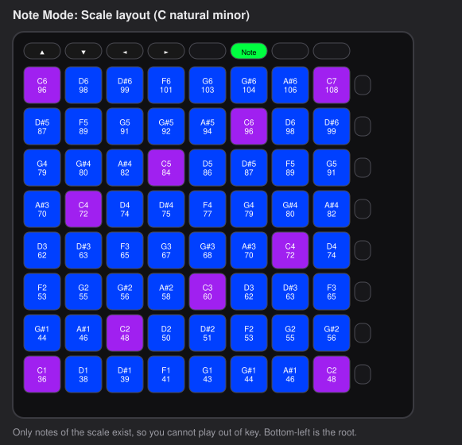

### 4.4 Drum layout

Four blocks of 4 x 4 pads (16 notes each), like a drum machine. The bottom-left
block starts at note 36, the standard kick drum of General MIDI. **Up** and **Down**
move the pads by a whole block (16 notes), **Left** and **Right** by 4 notes.

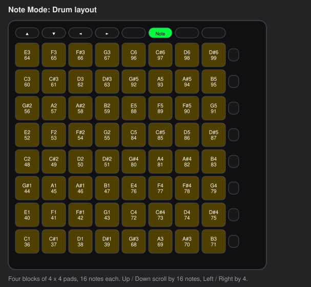

The pads are all lit the same way, because the Launchpad X cannot know which of
your instrument's drum pads have a sound.

### 4.5 Chord layout

The Chord layout plays chords with one finger, and can save chords for later.

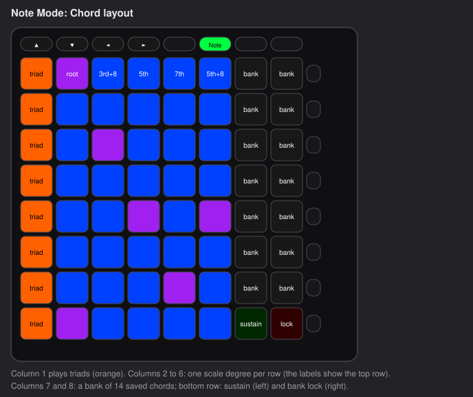

- **Orange column (left):** each pad plays a whole triad built on one note of the
  scale. The notes are kept within one octave so that the chords sound close
  together.
- **Columns 2 to 6, the note area:** each row belongs to one note of the scale
  (the bottom row is the first note). From left to right the pads are: the **root**,
  the **third** (one octave up), the **fifth**, the **seventh** and the **fifth**
  again (one octave up). Press three pads of a row together to play a chord; the
  left column of the note area runs through the scale from bottom to top.
- **Chord bank (the two columns on the right, top seven rows):** 14 slots to save
  chords in. **Save a chord:** hold an *empty* slot (dim white) and press notes or
  triads, then let go; or hold some notes first and then press an empty slot. **Play
  a saved chord:** press its slot (bright white).
- **Lock (bottom right, red):** while it is on (bright red) the bank cannot be
  changed. That lets you hold a saved chord with one finger and play melody notes
  on top without saving them by accident.
- **Sustain (bottom row, next to Lock, green):** when it is on (bright green) notes
  keep sounding after you let go. They stop when you switch sustain off. Press a
  sustained note again to play it again with the new force.

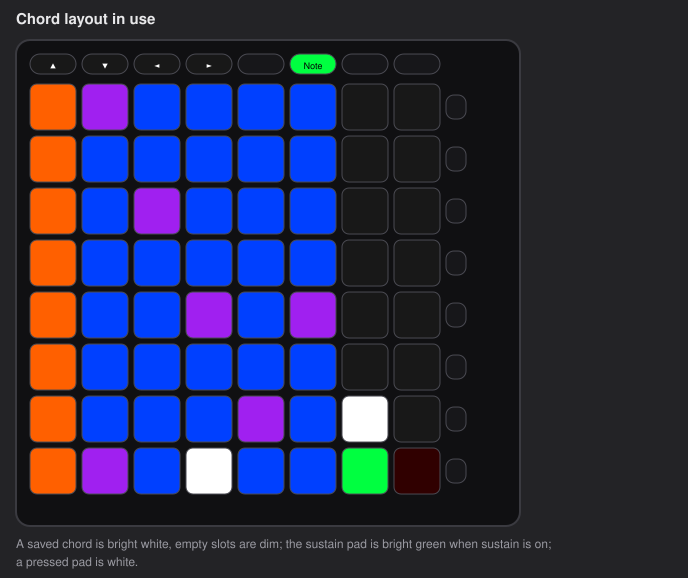

The **chord bank is saved** (it is still there after unplugging); the lock and the
sustain are switched off again. The scale, root, MIDI channel and the octave shifts are the same ones as in the
other layouts.

### 4.6 The settings page

Press **Note** while in Note Mode. The pads become switches:

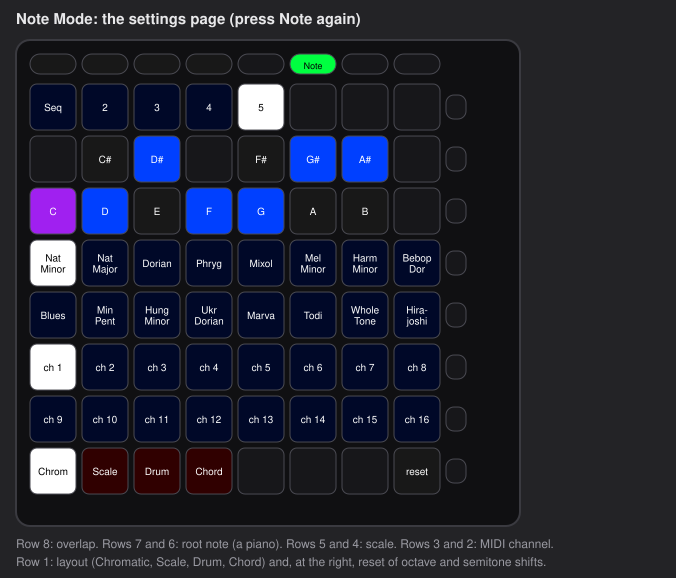

| Where | What it sets |
| --- | --- |
| **Top row, left (Seq, 2, 3, 4, 5)** | **Overlap** (Chromatic and Scale layouts): how the rows relate. 5 = guitar-like. 2, 3, 4 = more overlap. "Seq" = every pad is a different note (in Scale layout: each row starts one octave higher) |
| **Rows 7 and 6: a piano** | the **root note** (the key). The pad of the current root is purple |
| **Rows 5 and 4: 16 scales** | Natural Minor, Natural Major, Dorian, Phrygian, Mixolydian, Melodic Minor, Harmonic Minor, Bebop Dorian, Blues, Minor Pentatonic, Hungarian Minor, Ukrainian Dorian, Marva, Todi, Whole Tone, Hirajoshi |
| **Rows 3 and 2** | the **MIDI channel** 1 to 16 (channel 10 is usually for drums) |
| **Bottom row, left (Chrom, Scale, Drum, Chord)** | the **layout**. The selected one is lit brightly |
| **Bottom row, right (reset)** | octave and semitone shifts back to zero |

Press **Note** again to return to playing. The layout, overlap, scale, root note and
MIDI channel are **saved** a moment after you close the settings page, and are still
there after you unplug the Launchpad (the octave and semitone shifts start at zero
again). The very first time it is C minor, overlap 5, channel 1.

**Recipes.** *Play in D major:* Note, tap the D on the piano, tap Natural Major, Note.
*Send to a drum machine on channel 10:* Note, tap channel 10 (rows 3 and 2), pick the
Drum layout, Note.

## 5. Custom Modes

Custom Modes turn the pads into controllers for your synthesizer or software:
faders, switches, drum pads, a keyboard. There are **eight built-in modes**.

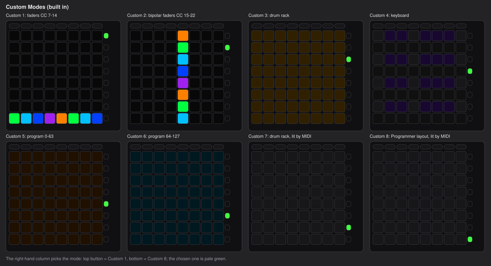

**Using them**

1. Press **Custom**. The pads show the mode you used last.
2. Choose the mode with the **eight buttons in the right-hand column**: the top
   button is Custom 1, the bottom button is Custom 8. The active one is pale green.
3. To change the **MIDI channel** of a mode, **hold Capture MIDI**. The two bottom rows
   of pads show channels 1 to 16. Tap one, then let go. Each mode has its own channel
   (all start on channel 1).

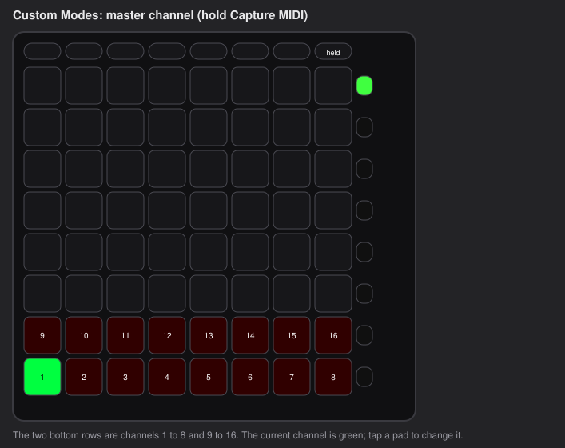

| Mode | What the pads do |
| --- | --- |
| **Custom 1** | **8 vertical faders** (one per column), controller numbers **7 to 14**. Tap a pad to set the level; everything below it lights |
| **Custom 2** | **8 horizontal faders** (one per row; the top row is the first), controllers **15 to 22**. They go from the middle: right of the middle for high values, left of it for low values. They start in the middle |
| **Custom 3** | a **drum rack**: the same notes as the Drum layout of Note Mode (bottom left = 36). It follows how hard you press, and aftertouch |
| **Custom 4** | a **piano keyboard**: white keys in one row, black keys in the row above, four octaves from C = note 36 |
| **Custom 5** | **program changes 0 to 63**, one per pad. Tap a pad to switch the sound of your instrument |
| **Custom 6** | **program changes 64 to 127** |
| **Custom 7** | the drum rack of Custom 3, but **dark**. Notes sent *to* the Launchpad (on the mode's channel) light the pads; the strength of the note chooses the color |
| **Custom 8** | the **Programmer layout** (every pad has the note number row x 10 + column), also dark and lit by incoming notes. Use it to show things from software on the pads |

A fader has 8 positions. They send the values 0, 18, 36, 54, 72, 90, 108 and 127.
(A bipolar fader therefore has no exact middle value; it sends 54 or 72 next to the middle.)

Notes that are held when you change mode are ended. The **chosen mode and the master
channel of each mode are saved**; toggle states and fader positions start again after
you unplug the Launchpad.

**Modes made with Novation Components** cannot be loaded yet (see
[What the firmware cannot do](#11-what-the-firmware-cannot-do-yet)).

## 6. The sequencer

> This chapter describes the default sequencer (Launchpad95 style). The firmware can also
> be built with a Novation-style sequencer (4 tracks, 8 patterns, scenes, chains,
> probability and more) instead; its controls are in
> [novation-sequencer.md](novation-sequencer.md). You choose when building:
> `LPX_SEQUENCER=novation cargo lpx`.

The sequencer plays patterns by itself: **5 tracks** (track 1 is drums, tracks 2
to 5 are melodic), each with up to **64 steps**, its own MIDI channel and its own
speed. It has its own clock, so the Launchpad can play a beat without a computer.
It goes out as notes on the USB MIDI port.

**Open it:** hold **Capture MIDI** and press **Custom**. **Leave it:** press **Custom**
(it keeps playing). **Start and stop:** the **Note** button is **Play** while you are
in the sequencer.

**Saving.** The working state is forgotten when you unplug the Launchpad, but you can
**save up to 8 projects** and load them later (6.9).

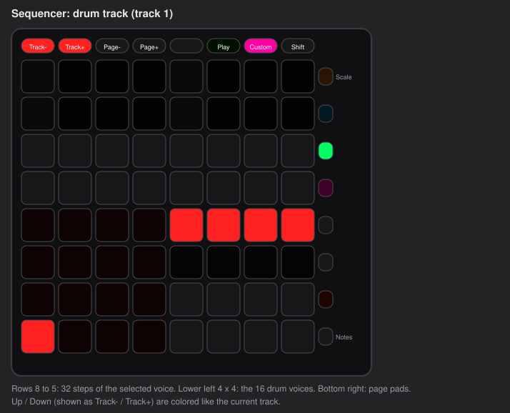

### 6.1 The top row and the right-hand column

| Button | Alone | With Shift (hold Capture MIDI) |
| --- | --- | --- |
| **Up** / **Down** | previous / next track (the buttons glow in the track's color) | transpose one octave up / down |
| **Left** / **Right** | previous / next page of 8 steps | tempo -1 / +1 BPM |
| **Note** | **Play** and stop | |
| **Custom** | leave the sequencer | |
| **Capture MIDI** | **Shift** | |

The right-hand column (top to bottom) chooses *what the pads edit* on a melodic
track, or works as a hold button on a drum track:

| Button | Melodic track | Drum track |
| --- | --- | --- |
| **Scale** (top) | open or close the scale overlay (6.6) | same |
| **Probability** | edit probability | hold, then tap a step to lower its probability |
| **Rate** | step through the step speeds of this track | same |
| **Random** | fill the current lane with random values inside the loop | randomize the current voice |
| **Length** | edit note length | |
| **Octave** | edit octave | |
| **Velocity** | edit loudness | hold, then tap a step to lower its loudness |
| **Notes** (bottom) | edit notes | |

**With Shift held** the right-hand column buttons become function buttons:

| Shift + button | Function |
| --- | --- |
| **Notes** | **Record**: hold it to turn the pads into a transposition keyboard (6.7) |
| **Velocity** | **Clear**: hold it and tap a step, page pad or drum voice to erase it. Tap it alone to erase the whole current track |
| **Octave** | **Duplicate**: copy the loop behind itself and double its length |
| **Length** | **Fixed length**: hold it and tap a page pad to set where the loop ends |
| **Random** | **Mute**: hold it and tap a step or drum voice to mute it. Tap it alone to mute the whole current track |
| **Rate** | **Solo** the current track |
| **Probability** | the **Projects** overlay: load and save (6.9) |
| **Scale** | not used |

> **How to use the hold functions.** Press Shift, press and hold the function button,
> *then let go of Shift*, then use the pads, and release the function button last.
> While Shift is held the pads show the *settings* page instead (6.5).

### 6.2 Tracks, pages and loops

Each track has 8 pages of 8 steps, 64 steps in all. A **loop** is the part that
repeats. On a melodic track the bottom row of pads holds the 8 **page pads**:
a page's pad is dim if it is in the loop, bright if you are looking at it, and white
while it plays. Tap a page pad to look at that page. Hold one page pad and tap another
to make that range the loop. Or use **Fixed length** (Shift + Length) to set the end.

### 6.3 Melodic tracks

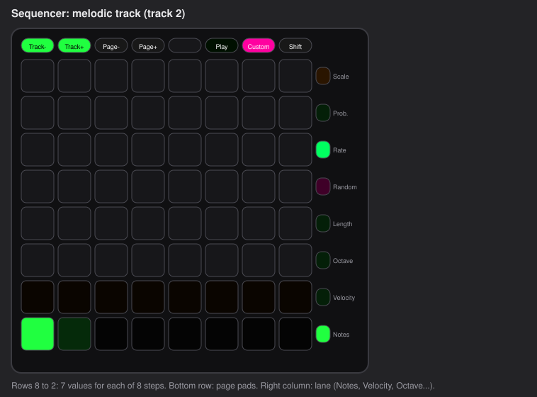

The top seven rows are 8 steps (the columns) with 7 values (the rows). The right-hand
button column chooses what the seven rows mean:

| Lane | The seven rows are | Tap a pad to |
| --- | --- | --- |
| **Notes** | 7 notes of the scale, the root at the bottom | switch the step on at that note (tap the lit pad again to switch it off) |
| **Octave** | 3 octaves down to 3 up (middle row = normal) | set the octave |
| **Velocity** | 7 levels of loudness | set it |
| **Length** | 1/4, 1/2, 3/4, 1, 2, 4, 8 steps | set how long the note lasts |
| **Probability** | 12%, 25%, 37%, 50%, 62%, 75%, 100% | set how likely the step plays |

Notes follow the scale and root of the project plus the transposition.

### 6.4 Drum tracks

- **Rows 8 to 5:** 32 steps of the selected drum voice (row 8 is the first 8 steps).
- **Lower left, 4 x 4 pads:** the **16 drum voices**. Tap one to select it (it also
  plays its sound).
- **Right half of rows 4 and 3:** the 8 page pads (blocks of 8 steps).
- Tap a **step** to switch a hit on or off. New hits take their loudness from how hard
  you press. Hold **Velocity** or **Probability** (right-hand buttons) and tap a step to
  lower that value one level.

Voices start at note 36 (the General MIDI kick) and rise by one semitone per pad.
Drum tracks are never transposed.

### 6.5 Settings (hold Shift)

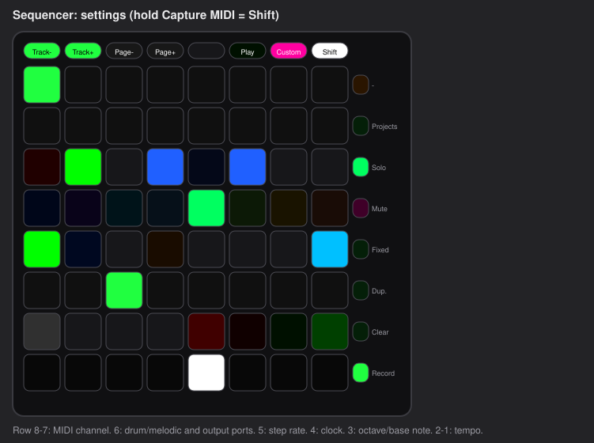

While Shift is held, tap pads to change settings of the current track and the whole
sequencer:

| Row | Pads |
| --- | --- |
| 8 and 7 | the **MIDI channel** 1 to 16 of the current track |
| 6 | pad 1 = drum track, 2 = melodic track; 4 = send to the **MIDI** port, 5 = send to the **DAW** port |
| 5 | the **step speed**: 1/4, 1/4 triplet, 1/8, 1/8 triplet, 1/16, 1/16 triplet, 1/32, 1/32 triplet |
| 4 | 1 = internal clock, 2 = follow an **external clock**; 4 = send MIDI clock out; 8 = transposition from MIDI channel 16 on/off |
| 3 | melodic: the base octave; drum: the base note (C0, C1, C2, C3) |
| 2 | 1 = **tap tempo** (tap in time); 5, 6, 7, 8 = tempo -10, -1, +1, +10 BPM |
| 1 | tempo presets 80 to 150 BPM |

The tempo starts at 120 BPM. Track 1 starts on MIDI channel 10 (drums), tracks 2 to 5 on
channels 1 to 4.

### 6.6 Scale overlay

Tap **Scale** (top right-hand button). Rows 8 and 7 are a piano to choose the root
note; rows 5 and 4 choose one of 16 scales: Major, Minor, Dorian, Phrygian, Lydian,
Mixolydian, Locrian, Harmonic minor, Melodic minor, Major pentatonic, Minor
pentatonic, Blues, Whole tone, Diminished, Hungarian minor, Chromatic. Press
**Scale** again to close it.

### 6.7 Transposing while it plays

- **Shift + Up / Down:** one octave up / down.
- **Record** (Shift + Notes, hold it, release Shift): the pads become three one-octave
  piano keyboards to choose the transposition; the top-right pad resets it.
- Send notes to the Launchpad on **MIDI channel 16** (middle C = no transposition) and
  the sequence follows your keyboard. Switch this off in the settings (row 4, pad 8).

Transposition affects melodic tracks only.

### 6.9 Saving and loading projects

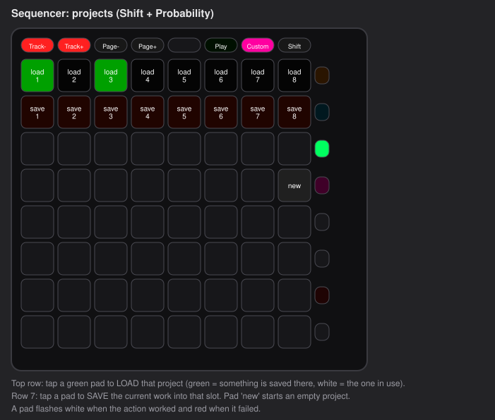

Hold **Shift** and tap **Probability** (the Shift layer's Projects button): the pads show the
projects. Tap **Probability** with Shift again to close it.

- **Load:** tap a pad in the top row (load 1 to 8). A slot that has something saved is
  green; the one you loaded last is white. The current work is replaced.
- **Save:** tap a pad in row 7 (save 1 to 8) to save everything of the sequencer (all 5
  tracks, tempo, scale, clock and the settings) into that slot. It replaces what was there.
- **New:** the pad in the right-hand column of row 5 starts an empty project (it does not delete
  any saved one).

A pad flashes **white** when it worked and **red** when it did not (for example if the memory
could not be written; nothing is lost in that case). Saving takes a moment, and the
sequencer stands still while it writes, so save while it is stopped. Saved projects are
kept in a protected area of the Launchpad's memory (see
[storage-design.md](storage-design.md)); a failed or interrupted save never damages the
copy that was there before.

### 6.8 Clock and sync

Normally the sequencer uses its own clock. Choose **external clock** in the settings
(row 4, pad 2) to follow another device's MIDI clock; **Play** then waits for the clock
to start. With **send clock** switched on (row 4, pad 4) the Launchpad sends MIDI clock
and start/stop to other gear.

**Recipes.** *A beat:* open the sequencer (track 1, drums), tap pad 11 to pick the kick
(it plays), tap steps on row 8 (steps 1 to 8), pick the next voice, and so on, then
Play. *A melody:* press **Down** to go to track 2, choose the **Notes** lane, tap
pads (columns = steps, rows = notes of the scale), then Play.

## 7. Session mode (Ableton Live)

A short tap on **Session** opens Session mode, the mode for Ableton Live's Session
view (launching clips). It is the firmware's *DAW mode*: the Launchpad talks to
Live's control-surface software on the **DAW** MIDI port, and Live lights the pads.
Nothing happens on the pads until Live is connected.

To use it: in Live's settings (Link, Tempo & MIDI), choose the Launchpad X control
surface and set its input and output to the Launchpad's **DAW** port. This was not tried
with a real Live installation by us. In this mode pad and button presses are sent on
the **DAW** port (notes and controllers), not on the MIDI port.

To leave Session mode press **Note** (you return to Note Mode), or hold **Session**
for Setup.

## 8. Performance and Programmer mode

These two modes are for people who want the Launchpad as a plain input device and
let a computer program decide what everything does. They are **not** the default; choose them in
Setup (chapter 9).

**Performance mode.** The pads are dark until a program lights them. Each pad sends a
note on MIDI channel 1 in a drum-rack arrangement (the bottom-left pad is note 36). A
program lights a pad by sending a **Note On** for the same note on channel 1 with a
**color** as the velocity (the Novation color palette, chapter 9); **Note Off** switches
it off. Controller numbers 91 to 98 light the top-row buttons.

**Programmer mode.** Every pad and button sends a **Note On** with its own number: the pads
use `row x 10 + column` (bottom-left = 11, top-right = 88), the top row 91 to 98, the
right-hand column 19 to 89. Notes and controllers sent to the Launchpad light them in
the same way as in Performance mode. In this mode the Note button does not leave the
mode, because your software needs every button.

## 9. Setup

Hold **Session** for about half a second. The pads show a word, and the right-hand column
buttons switch between **five pages**. Press **Session** (it pulses red) to leave Setup;
the settings are saved then and are still there after the next power-up.

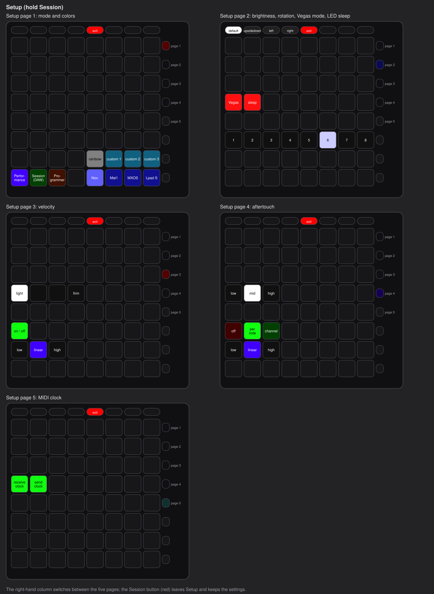

| Page | What you can change |
| --- | --- |
| **1: mode and colors** | the mode (bottom row, left): **Performance**, **Session (DAW)**, **Programmer**. The **color palette** (bottom row, right: the Novation palette, "Mat1jaczyyy", "MXOS", the old Launchpad S palette) and three **custom palette banks**; the rainbow pad opens a palette editor when a custom bank is chosen |
| **2: brightness and rotation** | **brightness** in 8 levels (the row of pads). **Rotation** with the top-row arrows: default, upside down, left, right. Rotation is not saved. Two more pads (row 5, left): **Vegas mode** (pad 1) runs a rainbow light show after 5 minutes without a button press, **LED sleep** (pad 2) turns all LEDs off after 5 minutes (after 10 if Vegas mode is on as well). The next button press wakes the LEDs and does nothing else. Green = on, red = off (the default) |
| **3: velocity** | switch **velocity sensitivity** on or off (the pad in row 3). When it is off every note is played at full strength. Pick a **curve** (row 2): **low** (the same press gives quieter notes, you must press harder), **linear**, **high** (the same press gives louder notes). Row 5 (four pads) is the **pad trigger threshold**: how hard a press must be to count, from the left (lightest, the default) to the right (firmest). Raise it if pads trigger by themselves |
| **4: aftertouch** | **off**, **per note** (polyphonic) or **channel** aftertouch; the same three curves (low, linear, high). Row 5 (three pads) is the **aftertouch threshold**: how hard you must press before aftertouch starts, low, medium (the default) or high |
| **5: MIDI** (the fifth button down from the top, second from the bottom) | Row 5: pad 1 = the Launchpad **uses incoming MIDI clock and start/stop**, pad 2 = the sequencer **may send MIDI clock and start/stop**. Green = on (the default), red = off. When receiving is off, clock from the computer is ignored everywhere (sequencer and the pulsing lights) |

If your Launchpad does not light up on a weak USB port (for example a phone), lower the
**brightness**.

## 10. Connecting to other gear: MIDI

The Launchpad appears as **two MIDI ports** over USB, named "LPX (MIDI)" and "LPX (DAW)"
(the original firmware calls them "LPX MIDI" and "LPX DAW"):

- **MIDI port:** the notes and controllers of Note Mode, Custom Modes, the sequencer,
  Performance mode and Programmer mode. Connect this one to your synthesizer, drum machine
  or music program.
- **DAW port:** only for Session mode (Ableton Live), and optionally for the sequencer.

The Launchpad X has no 5-pin MIDI socket; to connect old gear use a USB-to-MIDI
interface or a computer.

**What each mode sends**

| Mode | Messages |
| --- | --- |
| Note Mode | Note On / Note Off on the chosen channel (default 1), strength = how hard you press; aftertouch per Setup |
| Custom Modes | notes, controller changes (faders), program changes, on the mode's channel |
| Sequencer | notes on each track's channel; optional MIDI clock, start and stop |
| Session mode | notes and controllers on the DAW port, following the Novation DAW protocol |
| Performance / Programmer | Note On with the pad number or drum number |

**Messages to the Launchpad.** Besides lighting pads (Performance, Programmer, Custom 7
and 8), the Launchpad answers the standard **Device Inquiry** (it reports itself as a
Launchpad X with the firmware version 0999) and understands the mode and light SysEx of
the CoreFW project. In sequencer settings, MIDI channel 16 notes can transpose a
sequence.

**Software that looks for the original port names** may not find the Launchpad,
because the names are "LPX (MIDI)" and "LPX (DAW)" with this firmware.

## 11. What the firmware cannot do (yet)

- **Saving everything.** Saved are: the 8 sequencer projects, the Note Mode
  preferences (layout, overlap, scale, root, channel, chord bank), the Custom Mode
  preferences (mode, channels) and the Setup settings. Not saved: toggles and fader
  positions, octave and semitone shifts, sustain and lock, the sequencer's running
  state, and rotation. There is no way to wipe saved data from the Launchpad itself,
  and no backup.
- **Custom Modes from Novation Components.** The eight built-in modes work; modes you
  make in Components cannot be loaded.
- **Ableton-dependent features** such as a Drum layout that follows your Ableton drum rack
  (the Drum layout is fixed).
- **A Chord button and a separate Sequencer button.** The Launchpad X has none, so
  Chord is a layout of Note Mode and the sequencer is on Capture MIDI + Custom.
- **MIDI out of a 5-pin socket.** The Launchpad X has none.
- **Novation's own modes at the same time.** This firmware **replaces** Novation's
  firmware; to use Novation's original modes you must go back to the original firmware
  (chapter 12).

## 12. Installing, updating and going back

**How it works, in short.** The Launchpad has a small built-in program, the
**bootloader**, that is always there and cannot be replaced by the normal update. It
receives new firmware and checks it before it is installed. If a transfer goes wrong the
Launchpad stays in the bootloader and keeps its old firmware, and you can try again. You
can always get back to Novation's firmware with **Novation Components**
(components.novationmusic.com).

> **Before you start:** use a good USB cable, plug the Launchpad **directly** into the
> computer (no hub), and close every program that uses MIDI (music programs, a web
> browser with Novation Components open). On **Linux**, do **not** use the web-based
> flashers: they fail on Linux with a red F on the pads (nothing is damaged). The
> method below was tested.

### 12.1 Getting into the bootloader

1. Unplug the Launchpad.
2. **Hold Capture MIDI** (top row, right).
3. While holding it, plug the USB cable back in. The pads show the bootloader
   screen (device ID, brightness, version pads and a green start pad at the bottom right).

To leave without changing anything, press the **green pad at the bottom right**
(the installed firmware starts), or unplug the Launchpad.

### 12.2 Installing the firmware (Linux)

You need the firmware file `core-launchpad-x.syx` (built from the source, see
12.4), and the tool `amidi` (from the package `alsa-utils`).

1. Check that the file is the one you expect. If you got it from someone, ask for its
   checksum and compare it: `sha256sum core-launchpad-x.syx`.
2. Put the Launchpad into the bootloader (12.1) and find its port:
   `amidi -l` shows a line with "Launchpad X Bootloader" (for example `hw:1,0,0`).
3. Send the file (it takes about half a minute; do not unplug):
   `amidi -p hw:1,0,0 -i 10 -s core-launchpad-x.syx`
4. The Launchpad restarts by itself and shows the boot animation. On a **wrong
   or damaged transfer** it shows a **blinking red F** and stays in the bootloader:
   unplug it, enter the bootloader again and repeat step 3.

On **Windows and macOS** the same file can be sent with a SysEx tool, or with the
web-based CoreFW flasher (reported to work on Windows). These ways were not tried by us.

### 12.3 Going back to Novation's firmware

1. Open **Novation Components** (components.novationmusic.com) in a browser that supports
   WebMIDI (Chrome, Edge) with the Launchpad connected.
2. Components offers the firmware update. Install it. This brings the Launchpad back to the
   original firmware, including the original names of the MIDI ports.

If Components does not see the Launchpad, enter the bootloader (12.1) first; Components can
install the original firmware from there too.

### 12.4 Building the firmware yourself

For people who build programs: with Rust and `binutils-arm-none-eabi` installed, run
`cargo lpx` in the project folder; it writes `build/core-launchpad-x.syx`. Always build the
Launchpad X with `cargo lpx` and nothing else. Then check the result before you send it:
`python3 tools/verify_lpx.py target/thumbv7em-none-eabihf/release/core build/lpx/fw.bin
build/lpx/fw.syx tools/syxtool.py` must print **PASS**.

### 12.5 If something goes wrong

- *The pads stay dark after an update.* Enter the bootloader (12.1) and send the file
  again, or go back to Novation's firmware (12.3).
- *The Launchpad does not show up as a bootloader.* Try another USB cable and port, or
  another computer. If it **never** appears, do not keep trying: see
  [lpx-port-safety.md](lpx-port-safety.md).
- A technical report of everything done to the hardware, and what was proven and not
  proven about its safety, is in [lpx-port-safety.md](lpx-port-safety.md).

## 13. What has been tested

| Part | Status |
| --- | --- |
| Entering the bootloader, installing firmware, going back, recovering from a failed transfer | tested many times on a real Launchpad X |
| Boot into CoreFW; the pads sending notes on channel 1 to a MIDI instrument | observed on a real Launchpad X (a MIDI log shows the note messages) |
| Chord layout, Custom Modes, the sequencer, Session tap, Setup pages with the size-optimized build | built and tested by computer programs (unit tests), **not yet confirmed on a real Launchpad** |
| Saving and loading a sequencer project | **tested on a real Launchpad X**: saved (white flash), the chip was dumped and checked (valid, only the allowed bytes changed), and after unplugging the pattern loaded back |
| Saving of the Note Mode and Custom Mode preferences | tested by computer programs that simulate the memory chip and **cut the power at every step of a save**; not yet verified on the Launchpad itself (see [storage-design.md](storage-design.md)) |
| Pad response and LED smoothness of the size-optimized firmware | not yet confirmed |
| Ableton Live Session mode | not tried |
| Windows and macOS installation | not tried |

## 14. Troubleshooting

| Problem | What to do |
| --- | --- |
| Nothing lights up after plugging in | the pads are lit by the firmware; wait for the boot animation. If the Launchpad is on a weak USB port, try another port. If it stays dark, enter the bootloader (12.1) |
| The pads are lit but I hear nothing | the Launchpad makes no sound itself. Connect its **MIDI** port to an instrument or a music program and set it to receive on channel 1 |
| Pads do not play, or the page looks different | you probably are on a settings page or in another mode. Press **Note** (once or twice) to come back to playing |
| **Custom** shows faders, not the sequencer | the sequencer opens with **Capture MIDI held** while you press **Custom** |
| The Note button does nothing | in the sequencer it is **Play**; in Programmer mode the computer program gets the button. Press **Custom** (sequencer) or use Setup (Programmer) first |
| A short tap on Session switched to a mode with dark pads | that is Session mode (for Ableton Live). Press **Note** to come back |
| A hung or stuck note | change the octave and back, or press **Note** twice; leaving a mode ends every held note |
| My software does not find the Launchpad | it looks for the original port names. Choose the ports "LPX (MIDI)" and "LPX (DAW)" by hand |
| A pad flashes **red** when I save or load a project | the action failed (an empty slot cannot be loaded; a save that could not be read back is refused). Your earlier saved copy is untouched. Try again; if it keeps failing the memory chip may not be the expected one |
| A **blinking red F** appeared during an update | the transfer was not good. Nothing is damaged. Enter the bootloader again and resend the file (12.2) |

## 15. Words explained

- **Firmware:** the program that runs inside the Launchpad.
- **Bootloader:** the small program that installs firmware. It is always there.
- **MIDI:** the language music equipment uses: "play this note", "move this fader".
- **MIDI channel:** one of 16 "channels" on one connection; an instrument listens to one
  of them.
- **Note On / Note Off:** start and stop a note.
- **Controller (CC):** a message for a knob or fader (numbers 0 to 127).
- **Program change:** a message that chooses another sound in an instrument.
- **Velocity:** how hard a pad was pressed, 1 to 127.
- **Aftertouch:** pressing harder *after* the note has started.
- **Scale and root:** a set of notes that sound good together, and the note it starts on.
- **Octave, semitone:** an octave is 12 semitones; a semitone is the next key on a piano.
- **SysEx:** special long MIDI messages used for settings and updates.
- **DAW:** music software ("digital audio workstation") such as Ableton Live.
